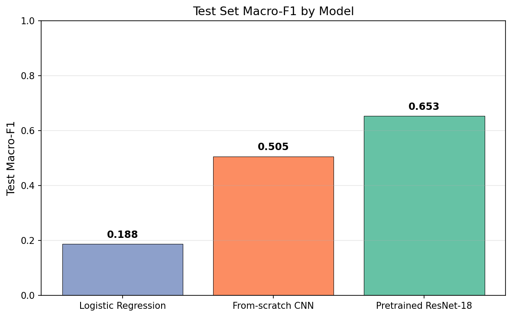
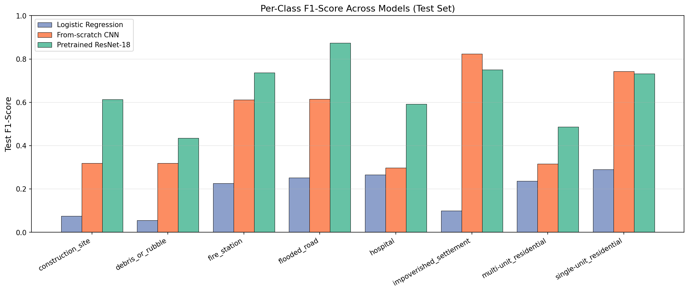
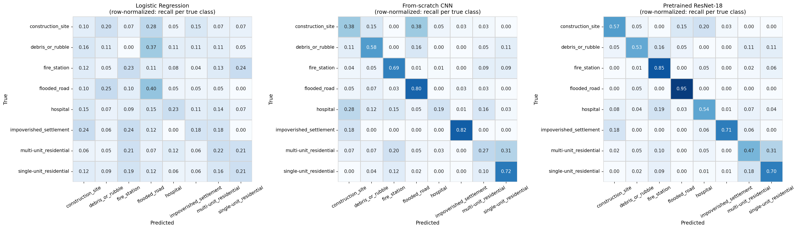

# Critical Infrastructure and Post-Disaster Damage Classification from Satellite Imagery

**Final Project Report**  

**Team Members:** Owen Loughery, Carson Nuebert

**Course:** DATA 402

## 1. Introduction

When a natural disaster hits a populated area, emergency responders need to know two things as fast as possible: where the damage is, and where critical resources like hospitals and fire stations are located. Right now this work is mostly done by hand. Analysts at agencies like FEMA, the Red Cross, and the Humanitarian OpenStreetMap Team look at satellite imagery one tile at a time and label what they see, which does not scale when something like a hurricane affects an entire region overnight.

The goal of this project is to train machine learning models that automatically classify satellite image tiles into categories that matter for disaster response. We frame this as a multi-class image classification problem with eight target categories that span visible damage (flooded roads, debris), critical infrastructure (hospitals, fire stations), and different types of residential zones, plus construction sites as a confounder class.

This problem matters because organizations actively work on it. The xView2 challenge, SpaceNet competitions, and groups like Planet Labs and the World Bank all fund work in this space. The problem is also personally relevant since we live in California, where wildfires are an annual event and SLO County itself has been hit by major fires within the last decade. Automated damage assessment is the kind of thing that helps emergency response teams make faster decisions when minutes matter.

Our project goal is not to achieve state-of-the-art performance on this benchmark. Instead, we wanted to build a clean comparison across three model tiers and measure how much each specific capability adds to performance. The three models we built (logistic regression on flattened pixels as a baseline, a from-scratch CNN, and a pretrained ResNet-18 fine-tuned to our task) each add exactly one capability over the previous model: spatial structure awareness for the CNN, and external prior knowledge from ImageNet pretraining for the ResNet. By comparing them on the same data with the same evaluation, we can quantify the value of each capability separately.

## 2. Dataset and Preprocessing

### 2.1 Source

We use the Functional Map of the World (fMoW) dataset, released by IARPA in 2018 alongside a CVPR paper by Christie, Fendley, Wilson, and Mukherjee. The full fMoW dataset contains over one million high-resolution satellite images across 63 categories from over 200 countries. We use the RGB version of the imagery, which is hosted publicly on AWS S3 and accessible anonymously without an AWS account.

### 2.2 Class selection

We selected 8 of the 63 fMoW categories based on relevance to disaster response. The selected classes fall into three functional groups: visible damage (flooded_road, debris_or_rubble), critical infrastructure (hospital, fire_station), and population zones (single-unit_residential, multi-unit_residential, impoverished_settlement). We included construction_site as a deliberate confounder, since construction sites visually resemble debris fields and force the model to learn more discriminative features rather than relying on superficial similarities.

### 2.3 Sampling strategy

We did not download the full fMoW dataset (over 200 GB) because that would be impractical for a course project. Instead we built a custom Python pipeline (`data_loader.py`) that downloads only the images we need and preprocesses them for training.

For the training set, we sampled up to 1500 locations per class from fMoW's train split. The rare disaster categories (flooded_road, debris_or_rubble, impoverished_settlement, construction_site) have fewer than 1500 locations available, so we used a hybrid sampling strategy. For these "small" classes we kept all available temporal views per location (each fMoW location is photographed multiple times). For the larger classes we kept only one image per location. This hybrid approach gave the rare classes more total training images while preventing the larger classes from dominating, bringing the imbalance ratio from a worst case of about 12:1 down to roughly 3.3:1.

For validation and test, we sampled 400 locations per class from fMoW's val split, took exactly one image per location (so near-duplicate temporal views could not inflate evaluation metrics), and randomly split 50/50 into validation and test sets using a fixed random seed for reproducibility. Train and val/test come from completely disjoint sets of geographic locations because they were drawn from different fMoW splits, eliminating any possibility of leakage.

### 2.4 Final dataset sizes

| Split | Total Images | Smallest Class | Largest Class | Imbalance Ratio |
|-------|--------------|----------------|----------------|-----------------|
| Train | 14,103 | impoverished_settlement (1,366) | construction_site (3,326) | 2.4:1 |
| Validation | 580 | impoverished_settlement (16) | single-unit_residential (200) | 12.5:1 |
| Test | 585 | impoverished_settlement (17) | single-unit_residential (200) | 11.8:1 |

The training set is reasonably balanced thanks to our hybrid sampling. The validation and test sets have larger imbalance because the rare classes have very few locations available in fMoW's val split, but this primarily affects metric noise rather than the model's behavior at training time.

### 2.5 Image preprocessing

Each raw image comes with a paired JSON metadata file that includes a bounding box around the labeled object, ground sample distance, sun angles, timestamp, and other metadata. Our preprocessing reads the bounding box from each JSON file and crops the raw image to that region with 20% padding on each side, then resizes the crop to 224x224 pixels. The result is a uniform set of class-centered, fixed-resolution image chips ready for any standard image classification pipeline.

We chose 224x224 because it is the standard input size for most modern CNN architectures including ResNet, which makes the data directly compatible with our pretrained model in section 3.3.

For the logistic regression baseline we additionally downsample each 224x224 image to 64x64 at load time to keep the feature matrix manageable in memory. At 224x224 each image has 150,528 RGB features; at 64x64 it has 12,288. The 64x64 version still preserves enough visual information for a linear model to extract whatever signal is available in pixel space.

### 2.6 Augmentation

Training images go through data augmentation at load time: random horizontal flips, random vertical flips, and random rotations between -180 and 180 degrees. Satellite imagery has no canonical orientation, so any of these transformations produces a valid example of the same class. This effectively multiplies our training data several times over without requiring new images. Validation and test images do not get augmented because we want deterministic, reproducible evaluation.

### 2.7 Normalization

All images are normalized using ImageNet mean and standard deviation values (mean = [0.485, 0.456, 0.406], std = [0.229, 0.224, 0.225]). We use ImageNet statistics rather than computing our own dataset statistics because our final model uses pretrained ImageNet weights and expects inputs in that distribution. Using the same normalization throughout means our data pipeline works for all three models without modification.

### 2.8 Class imbalance handling

For each model, we compute class weights inversely proportional to training class frequency using the standard formula `n_samples / (n_classes * class_count)`. These weights make underrepresented classes count more heavily in the loss function, preventing the model from learning to just predict the majority class. We pass these weights to sklearn's `LogisticRegression` via `class_weight='balanced'` (which uses this exact formula internally) and to PyTorch's `CrossEntropyLoss` via the `weight` parameter.

### 2.9 Challenges encountered

Two practical challenges shaped our pipeline. First, we initially tried to do all data work on Google Colab with Google Drive storage. This worked for the download but the Drive integration proved unreliable for the volume of small files involved (over 33,000 raw files and 15,268 processed files). Drive frequently dropped connections and returned "file not found" errors on files it had just listed. We eventually moved the entire pipeline to local disk on a Windows laptop, which solved the I/O reliability issue at the cost of having to set up a local Python environment.

Second, fMoW labels are assigned at the location level, not the image level. This is particularly relevant for the flooded_road class, where multiple temporal views of the same location can show the road both dry and flooded. We accepted this as inherent dataset noise rather than building custom filtering logic, but it is worth noting that some training and test images labeled "flooded_road" do not actually show flooding.

## 3. Models and Methods

We implemented three models that span a clean progression from a linear baseline to a fine-tuned pretrained CNN. Each successive model adds exactly one specific capability over the previous one.

### 3.1 Model 1: Logistic Regression

The baseline model is multinomial logistic regression on flattened RGB pixel values at 64x64 resolution, giving 12,288 features per image. Features are z-score normalized using `StandardScaler` fit on training data and applied to all splits.

**Loss function:** weighted multinomial cross-entropy (with softmax over the 8 class logits), implemented via sklearn's `LogisticRegression` with `class_weight='balanced'`.

**Optimization:** L-BFGS, sklearn's default for multinomial logistic regression. We let it run for up to 1000 iterations.

**Regularization:** L2 (sklearn's default for LogisticRegression). The regularization strength is controlled by the inverse parameter `C`, where smaller C means stronger regularization.

**Hyperparameter selection:** we swept C across [0.001, 0.01, 0.1, 1.0, 10.0] and selected the value that maximized macro-F1 on the validation set. The best value was C=0.001, the strongest regularization in our grid. This makes sense given the model has 12,288 features but only 14,103 training samples, putting it in a regime where overfitting risk is high without strong regularization. We extended the grid downward to confirm the optimum was not even lower, but C=0.001 remained the best choice.

This model serves as the floor: it can find linear correlations between raw pixel intensities and class labels, but it has no notion of spatial structure (every pixel position is treated as an independent feature with no relationship to its neighbors).

### 3.2 Model 2: From-scratch Convolutional Neural Network

A custom CNN built from scratch in PyTorch. The architecture is a fairly standard small-CNN design:

- **Conv block 1:** Conv2d(3 → 32, kernel 3x3, padding 1), BatchNorm2d(32), ReLU, MaxPool2d(2). Output: [B, 32, 112, 112].
- **Conv block 2:** Conv2d(32 → 64), BatchNorm2d(64), ReLU, MaxPool2d(2). Output: [B, 64, 56, 56].
- **Conv block 3:** Conv2d(64 → 128), BatchNorm2d(128), ReLU, MaxPool2d(2). Output: [B, 128, 28, 28].
- **Conv block 4:** Conv2d(128 → 256), BatchNorm2d(256), ReLU, MaxPool2d(2). Output: [B, 256, 14, 14].
- **Classification head:** AdaptiveAvgPool2d(1) collapses spatial dimensions to 1x1, flatten, Dropout(0.5), Linear(256 → 8).

Approximately 360,000 learnable parameters total.

**Loss function:** weighted cross-entropy. The class weights are computed from training class frequencies and passed to `nn.CrossEntropyLoss(weight=...)`.

**Optimization:** Adam with learning rate 1e-3. Batch size 32. Trained for 30 epochs.

**Regularization:** dropout (0.5) before the final linear layer, batch normalization after each convolution, and data augmentation (flips and rotations) during training.

**Architectural rationale:** the standard pattern of 3x3 convolutions with padding=1 makes each conv layer spatially shape-preserving, so the conv layers handle channel expansion (3 → 32 → 64 → 128 → 256) while the pooling layers handle spatial reduction (224 → 112 → 56 → 28 → 14). This separation keeps the design clean and avoids needing to track spatial dimensions through every layer. The doubling channel pattern is the modern convention popularized by VGG and ResNet.

**Model selection:** we saved the model weights whenever validation macro-F1 reached a new high during training. The best epoch was epoch 25, with validation macro-F1 = 0.536.

### 3.3 Model 3: Pretrained ResNet-18 with Transfer Learning

ResNet-18 with weights pretrained on ImageNet, with the final fully-connected layer replaced for our 8-class problem. ResNet was selected because it is the canonical pretrained architecture for image classification in PyTorch, with weights directly available via `torchvision.models.resnet18(weights='DEFAULT')`. The 18-layer variant fits comfortably in our laptop GPU's memory (about 11 million parameters), whereas larger variants like ResNet-50 would have required smaller batch sizes.

The modification:

```python
from torchvision import models
model = models.resnet18(weights=models.ResNet18_Weights.DEFAULT)
num_features = model.fc.in_features  # 512
model.fc = nn.Linear(num_features, 8)  # replace 1000-class head with our 8 classes
```

The pretrained backbone retains its ImageNet-learned visual features (edges, textures, shape primitives) while the new final layer is initialized fresh and adapts to our 8 classes during training.

**Loss function:** same weighted cross-entropy as the from-scratch CNN.

**Optimization:** Adam with learning rate 1e-4. We used a lower learning rate than the from-scratch CNN (1e-4 vs 1e-3) because the pretrained weights are already in a good neighborhood, so we want gentle adjustments rather than large updates that could damage the learned features.

**Regularization:** same augmentation as the from-scratch CNN. ResNet has its own batch normalization built into every block. We did not add explicit dropout or weight decay.

**Training:** end-to-end fine-tuning (no layer freezing) for 30 epochs at batch size 32.

**Model selection:** same best-validation-F1 logic. The best epoch was epoch 13, with validation macro-F1 = 0.671.

### 3.4 Common evaluation methodology

For all three models we used the same train/val/test discipline: tune hyperparameters and select model checkpoints using only the validation set, then evaluate exactly once on the held-out test set to report final performance. The test set is never seen during any iteration of model development. We used macro-averaged F1 as our primary selection criterion because it treats every class as equally important regardless of how many examples it has, which is more appropriate than accuracy given our class imbalance.

## 4. Results

### 4.1 Headline test set results

| Model | Accuracy | Macro F1 | Weighted F1 | Macro Precision | Macro Recall |
|-------|----------|----------|-------------|-----------------|--------------|
| Logistic Regression | 0.221 | 0.188 | 0.237 | 0.199 | 0.210 |
| From-scratch CNN | 0.552 | 0.505 | 0.543 | 0.527 | 0.556 |
| Pretrained ResNet-18 | **0.668** | **0.653** | **0.666** | **0.652** | **0.665** |

The headline finding is the clean three-tier progression: each model adds meaningful capability over the previous one. The CNN improves macro-F1 by a factor of 2.7 over the logistic regression baseline, and the pretrained ResNet adds another 29% improvement on top of that.



Figure 1 shows the macro-F1 comparison visually. The three-tier story is immediately apparent: 0.188, 0.505, 0.653.

### 4.2 Per-class breakdown

| Class | LR | CNN | ResNet | LR → ResNet Gain |
|-------|-----|-----|--------|------------------|
| construction_site | 0.075 | 0.319 | **0.613** | +0.538 |
| debris_or_rubble | 0.055 | 0.319 | **0.435** | +0.380 |
| fire_station | 0.227 | 0.611 | **0.736** | +0.509 |
| flooded_road | 0.252 | 0.615 | **0.874** | +0.622 |
| hospital | 0.266 | 0.298 | **0.593** | +0.327 |
| impoverished_settlement | 0.100 | **0.824** | 0.750 | +0.650 |
| multi-unit_residential | 0.237 | 0.316 | **0.487** | +0.250 |
| single-unit_residential | 0.291 | **0.742** | 0.733 | +0.442 |



Figure 2 visualizes the per-class comparison. ResNet wins six of eight classes, with notably large margins on classes like construction_site, hospital, and flooded_road. The CNN beats ResNet on impoverished_settlement and essentially ties on single-unit_residential.

### 4.3 Confusion matrices



Figure 3 shows row-normalized confusion matrices for all three models side by side. Row normalization means each row sums to 1, so the diagonal values represent per-class recall (what fraction of true examples in each class were predicted correctly). Off-diagonal values show what the model predicted instead.

A few patterns are immediately visible:

The LR confusion matrix is mostly diffuse, with no class achieving recall above 0.40. The model spreads its predictions roughly evenly across all classes regardless of the true class, indicating it has not learned any reliable decision boundary in pixel space.

The CNN confusion matrix has strong diagonals for some classes (flooded_road at 0.80, impoverished_settlement at 0.82, single-unit_residential at 0.72) but very poor diagonals for others (hospital at only 0.19, with 28% of hospitals predicted as construction_site).

The ResNet confusion matrix has the most uniformly strong diagonals, with flooded_road at 0.95, fire_station at 0.85, impoverished_settlement at 0.71, and single-unit_residential at 0.70. The main remaining off-diagonal is multi-unit_residential being predicted as single-unit_residential (0.31), which reflects genuine visual similarity between these classes.

### 4.4 Validation vs test consistency

Final validation macro-F1 (LR 0.203, CNN 0.536, ResNet 0.671) and test macro-F1 (0.188, 0.505, 0.653) differ by only 1 to 3 points for each model. This small gap suggests we did not overfit our hyperparameters or model selection decisions to the validation set, and the test numbers are a reasonable estimate of how the models would generalize to unseen satellite imagery from similar geographic regions.

## 5. Analysis and Discussion

### 5.1 Why each model performs the way it does

The three-tier improvement is not random. Each model adds a specific capability that maps to specific gains.

The logistic regression baseline establishes the floor for what is achievable with no spatial reasoning. It can find linear correlations between specific pixel positions and class labels, but classes like single-unit_residential look very different in pixel space depending on where in the image the houses are located (top corner, middle, etc.). A linear model cannot generalize across these spatial translations, which is why even its best class (single-unit_residential) only reaches F1=0.291.

The from-scratch CNN's convolutional layers solve this problem by learning translation-invariant features. A filter that detects "house with yard pattern" works the same regardless of where in the image that pattern appears. This is what drives the large jump on classes with distinctive spatial structure: single-unit_residential goes from 0.29 to 0.74, impoverished_settlement from 0.10 to 0.82, flooded_road from 0.25 to 0.62.

The pretrained ResNet adds prior knowledge from millions of ImageNet images. Even though ImageNet contains no satellite imagery, the low-level visual features the network learned (edges, textures, shapes) transfer reasonably well to overhead views. The middle-level features (object parts, materials) also transfer to some extent. This brings particularly large gains on classes where subtle visual distinctions matter and where our 14,000 training images alone were not enough for the from-scratch CNN to learn good features. Hospital goes from 0.30 to 0.59, construction_site from 0.32 to 0.61, fire_station from 0.61 to 0.74.

### 5.2 Overfitting analysis

The training behavior of the three models differs significantly.

**The ResNet showed clear overfitting.** By epoch 30, training accuracy reached 0.935 while validation accuracy stayed around 0.628, a 30-point gap. Validation loss climbed steadily after epoch 7 even as training loss kept falling. This is expected behavior when fine-tuning an 11-million-parameter pretrained model on only 14,000 training images: the model has enough capacity to memorize specific training examples faster than it can extract generalizable patterns. The save-best-model strategy captured the optimal epoch (epoch 13) before overfitting degraded the model's generalization, so the model we evaluated on test was unaffected by the later overfitting. In retrospect, we could have used explicit early stopping to terminate training automatically when validation stopped improving, but the save-best approach gave us the same final result.

**The from-scratch CNN did not overfit.** Train and validation accuracy tracked each other closely throughout 30 epochs, ending at 0.567 train and 0.509 val. The lack of overfitting suggests the from-scratch CNN is actually closer to underfitting than overfitting at our current architecture and training time. More capacity (deeper network, more channels), longer training, or learning rate scheduling could potentially have pushed this model's performance higher without immediately running into overfitting.

**The LR baseline did not overfit either**, but for a different reason. The strong regularization (C=0.001) selected by the validation grid search effectively prevents the 12,288-feature model from memorizing the 14,000 training samples. We confirmed this was the right call because larger C values consistently gave worse validation performance.

### 5.3 Specific failure modes

**Hospital is the most persistent failure across all models.** Even the ResNet only achieves F1=0.593 on hospital, well below its average performance. The confusion matrix shows hospitals being confused with construction_site, fire_station, and residential classes. This is genuine task difficulty: separating a hospital from a generic large institutional or commercial building from overhead at 224x224 resolution is hard for any model that does not have access to context like signage, surrounding road networks, or characteristic helipad markings. A human expert might struggle with the same task.

**Multi-unit residential consistently confuses with single-unit residential.** The from-scratch CNN predicts 31% of multi-unit residential as single-unit, and the ResNet has the same confusion. These two classes are genuinely difficult to separate visually because they sit on a continuum of building density rather than being categorically distinct, and the boundary between "large single-unit" and "small multi-unit" is fuzzy in any dataset.

**Debris_or_rubble has the smallest test sample (19 examples) and the noisiest metrics.** F1=0.435 on ResNet sounds modest, but with only 19 examples in test, every individual misclassification swings F1 by roughly 5 percentage points. The true class-level performance lives somewhere in a wide confidence interval that we cannot pin down with this sample size.

### 5.4 Why the CNN beats the ResNet on impoverished_settlement

This is the one class where the smaller, simpler from-scratch CNN (F1=0.824) outperforms the larger pretrained ResNet (F1=0.750). Two possible explanations:

First, statistical noise. The test set has only 17 impoverished_settlement examples. A 7-point F1 difference (0.824 vs 0.750) translates to about one or two more correct classifications by the CNN compared to ResNet. With such a small sample, this could easily be random variation rather than a real difference in model capability.

Second, possible feature mismatch. ImageNet pretraining biases the ResNet toward features that work well on natural ground-level photographs. Impoverished settlements have a distinctive top-down visual signature (densely packed irregular structures, no road grid, characteristic rooftop materials) that does not closely resemble anything in ImageNet. The from-scratch CNN learned features specifically suited to overhead imagery from the ground up, which may have served it better on this very specific visual pattern. This explanation is more speculative but worth noting.

### 5.5 Tradeoffs

**Capacity vs. data.** ResNet-18 has roughly 30 times more parameters than our from-scratch CNN. With unlimited data, more capacity is always at least as good. With our limited 14,000 training images, the extra capacity becomes a liability: ResNet overfits hard while the from-scratch CNN does not. The pretrained weights save ResNet from the worst of this by giving it a good starting point that needs less data to refine, but the overfitting trajectory still showed up clearly during training.

**Training time vs. accuracy.** Training the LR baseline takes a few minutes on CPU. The from-scratch CNN takes about 30 minutes for 30 epochs on the laptop's RTX 3060. The ResNet takes about 60 minutes for 30 epochs on the same hardware. The 13.5-point F1 jump from CNN to ResNet is genuinely worth that extra training time, but for applications where compute is constrained, the from-scratch CNN's 0.505 F1 might be the right cost-benefit tradeoff.

**Test set size vs. confidence.** Our smallest test classes (impoverished_settlement, debris_or_rubble) have 17 and 19 examples respectively. This is large enough to compute F1 but small enough that individual per-class metrics are noisy. A larger test set would give us tighter confidence intervals and make small differences between models more interpretable.

### 5.6 Dataset limitations

The fMoW val set, which we used to draw our val/test data from, is limited in size for the rare disaster classes. We took all available locations for the smallest classes, so getting more data would require sampling from a different fMoW split (which would compromise the disjoint-locations property) or augmenting with a different dataset (which would introduce source bias).

Label noise is another limitation we noted in section 2.9. Specifically, the flooded_road class includes images where the road is not currently flooded but the location was photographed at a different time when it was. Our model treats every image labeled "flooded_road" as flooded, which means it learns from some images where there is no actual flooding to detect. This is a known characteristic of fMoW that we accepted rather than tried to fix.

### 5.7 Possible improvements

Several improvements were considered but not pursued due to time:

**Learning rate scheduling** (e.g., cosine annealing) could potentially improve the from-scratch CNN by smoothly reducing the learning rate as training progresses. This is a common technique for squeezing additional performance out of CNN training and could plausibly push the model to 0.55 F1 or higher.

**Larger pretrained backbone.** ResNet-50 has more capacity than ResNet-18 and would likely outperform it given our training set is small enough that overfitting is the bottleneck rather than data. We did not pursue this because of 6 GB GPU memory constraints on our laptop.

**Metadata fusion.** The original fMoW paper combined image features with metadata (sun angle, ground sample distance, country, timestamp). This consistently improves performance because the metadata correlates with the visual features in non-obvious ways. We did not pursue this because it would have added significant complexity to the pipeline and our cross-model comparison would no longer be apples-to-apples.

**Ensemble predictions.** Averaging the predictions of multiple models (the from-scratch CNN and ResNet) often produces better results than any single model. We could have explored this for marginal final-performance gains.

## 6. Conclusion

### 6.1 Major findings

This project successfully demonstrated a three-tier progression in classification performance on a satellite imagery problem with real disaster-response relevance. Each successive model added one specific capability and the resulting improvement quantified the value of that capability:

- Spatial structure awareness (LR to CNN): macro-F1 from 0.188 to 0.505, a factor of 2.7x improvement.
- Transfer learning from ImageNet pretraining (CNN to ResNet): macro-F1 from 0.505 to 0.653, an additional 29% improvement.

The final ResNet model achieved 0.668 test accuracy and 0.653 macro-F1, with the highest-value class (flooded_road) reaching F1=0.874 with 95% recall. For a disaster-response use case, this means the model could detect nearly every flooded road in test imagery, which is exactly the kind of class where high recall is more valuable than high precision.

### 6.2 Lessons learned

The most important methodological lesson was the value of disciplined train/val/test splits with the test set genuinely held out until the end. Our validation-to-test consistency (all three models within 1-3 points of their val performance) confirms that the discipline paid off and gave us honest final numbers.

The second lesson was about model capacity in relation to data size. The from-scratch CNN's lack of overfitting and the ResNet's clear overfitting illustrate that picking the right model size depends heavily on how much training data you have. For 14,000 images, a small CNN trained from scratch is at its capacity limit while a large pretrained model can already memorize the training set. Transfer learning is a way to use a large model's representational power without paying the full data cost.

The third lesson was practical. We initially built the pipeline on Google Colab with Drive storage, which proved unreliable at the scale of file operations we needed. Moving the entire workflow to local disk with a custom data pipeline (`data_loader.py`) made everything faster and more stable, and gave us full reproducibility because anyone can clone our repository, run the data pipeline, and recreate every result.

### 6.3 Future work

Possible directions to extend this project:

1. **Add metadata fusion** to the ResNet model, combining the visual features with the rich JSON metadata each fMoW image comes with. This would likely add several points of F1.
2. **Add learning rate scheduling and explicit early stopping** to the training procedure for both CNN models. Cleaner training dynamics, slightly better final results.
3. **Explore larger pretrained backbones** (ResNet-50, EfficientNet) once GPU memory is not a constraint. Likely additional performance gains.
4. **Investigate the impoverished_settlement anomaly** (where the from-scratch CNN beats the ResNet) on a larger test set to determine whether it is a real effect or sampling noise.
5. **Apply the model to before/after disaster imagery** to do change detection rather than just static classification. This would be the actual deployment use case and a natural extension of the per-image classification we built.

### 6.4 Source code

The complete project including the data pipeline, modeling notebook, and all visualizations is available at https://github.com/OwenLoughery/FMOW-Disaster-Image-Classification/tree/main. Reproducing our results requires only cloning the repository, installing dependencies, running `python data_loader.py` (which downloads and preprocesses all data from the public fMoW S3 bucket, taking 20-45 minutes one time), and running the cells of `fmow_modeling.ipynb` in order.
