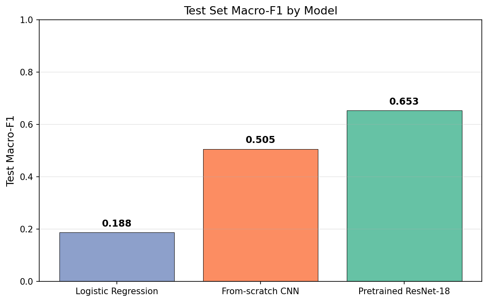
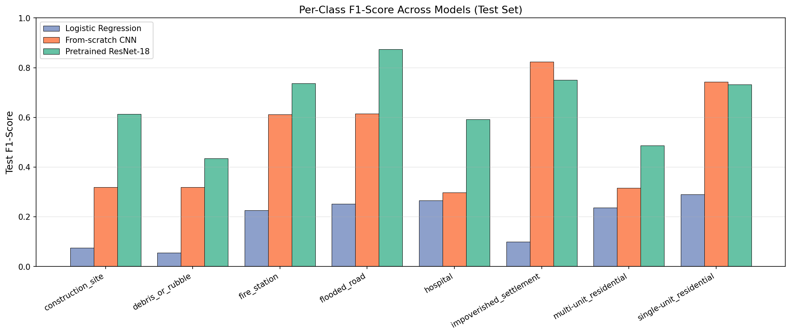
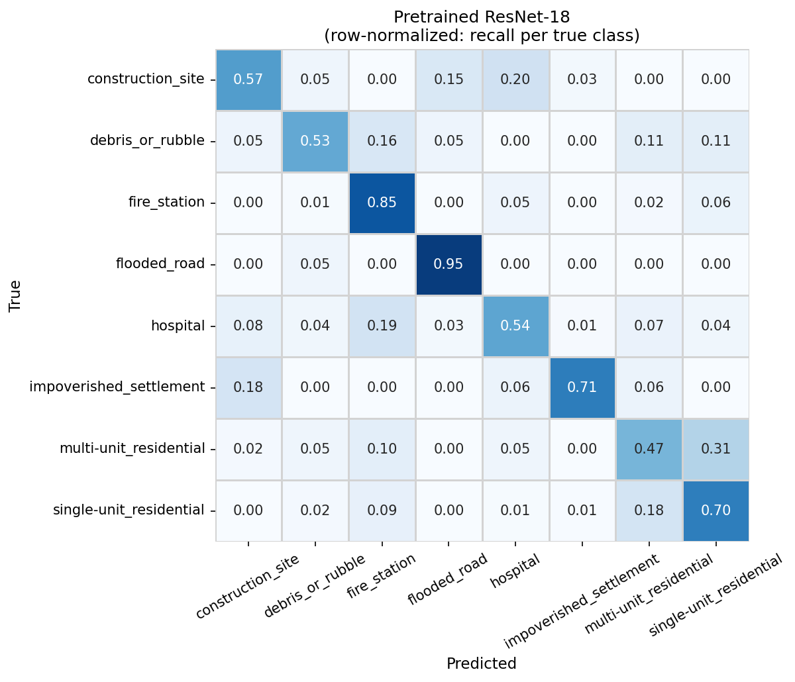

# Post-Disaster Satellite Image Classification

Classifying fMoW satellite imagery into eight categories that matter for disaster response, comparing a logistic regression baseline, a CNN trained from scratch, and a pretrained ResNet-18.

## The Problem

After a hurricane, flood, or wildfire, satellite imagery can help identify damage and critical facilities across a large area. Manually reviewing thousands of image tiles takes time, which makes automated classification useful as a first-pass tool.

I trained models to sort satellite image chips into eight categories covering visible damage, critical infrastructure, and different kinds of housing, and compared how far each type of model gets.

## Key Result

| Model | Test Macro-F1 |
|---|---:|
| Logistic Regression | 0.188 |
| CNN (trained from scratch) | 0.505 |
| Pretrained ResNet-18 (fine-tuned) | **0.653** |

Performance improved from 0.188 Macro-F1 with logistic regression to 0.505 with a CNN and 0.653 with a pretrained ResNet-18. Macro-F1 averages the F1 score of each class equally, so the small classes count as much as the big ones.

## Dataset

The images come from [Functional Map of the World (fMoW)](https://github.com/fMoW/dataset), RGB version: over a million satellite images across 63 categories, about 200 GB in total, stored in a public S3 bucket. Instead of downloading all of it, `data_loader.py` pulls only the images for the eight classes I used:

| Group | Classes |
|---|---|
| Visible damage | `flooded_road`, `debris_or_rubble` |
| Critical infrastructure | `hospital`, `fire_station` |
| Housing | `single-unit_residential`, `multi-unit_residential`, `impoverished_settlement` |
| Confounder | `construction_site`, included on purpose because it can look a lot like debris |

| Split | Images | Source |
|---|---:|---|
| Train | 14,103 | fMoW train split |
| Validation | 580 | fMoW val split, one image per location |
| Test | 585 | fMoW val split, one image per location |

I used the fMoW train split for training and sampled one image per location from the fMoW val split for validation and test, then split those 50/50. No fMoW location appears in more than one split. Validation and test are imbalanced (the test set has 200 single-unit residential images but only 17 impoverished settlement images) because the rarer classes have few locations in fMoW's val split.

## Approach

1. **Logistic regression.** Each image is downsampled to 64×64 and flattened into 12,288 pixel values, standardized, with balanced class weights. I picked the regularization strength (C) using validation Macro-F1.
2. **CNN from scratch.** Four convolution blocks (convolution, batch norm, ReLU, max pooling), then global average pooling, dropout, and a linear layer. About 391K parameters, trained on 224×224 images with augmentation and a class-weighted loss (Adam, learning rate 1e-3).
3. **Pretrained ResNet-18.** ImageNet weights with a new 8-class output layer, fine-tuned end to end with the same augmentation and loss at a lower learning rate (1e-4). About 11.2M parameters.

These steps aren't controlled ablations. Going from logistic regression to the CNN also changes the input size and adds augmentation, and going from the CNN to ResNet-18 changes the architecture, model size, and learning rate along with adding pretrained weights. So the CNN to ResNet-18 gain comes from switching to a pretrained ResNet-18 as a whole, not from pretraining alone.

## Results

ResNet-18 had the best F1 on 6 of the 8 classes. Its strongest classes:

- **flooded_road** (F1 0.874): it caught 38 of the 40 flooded roads in the test set.
- **fire_station** (0.736): it found 85% of the fire stations.
- **impoverished_settlement** (0.750) and **single-unit_residential** (0.733), where the CNN was already slightly better (0.824 and 0.742). With only 17 impoverished settlement test images, that gap comes down to one or two images.

The biggest gains from the CNN to ResNet-18 were on hospital (0.298 to 0.593), construction_site (0.319 to 0.613), and flooded_road (0.615 to 0.874). ResNet-18's weakest classes were debris_or_rubble (0.435), multi-unit_residential (0.487), and hospital (0.593).

## What the Model Struggled With

Rows are the true class and each row sums to 1, so the diagonal is recall. ([All three models side by side](comparison_confusion_matrices.png))

- **Multi-unit vs. single-unit housing.** 31% of multi-unit residential images were predicted as single-unit, and 18% of single-unit as multi-unit. Housing density is a continuum, and the line between the two isn't always clear from above.
- **Hospital vs. fire station.** 19% of hospitals were predicted as fire stations. Both are large institutional buildings, and the model only sees a cropped chip without signs or surrounding context.
- **Construction sites.** 20% were predicted as hospitals and 15% as flooded roads.
- **Small classes.** debris_or_rubble (19 test images) and impoverished_settlement (17) are small enough that one or two images noticeably change their F1, so I wouldn't read much into differences on those two.

## Data and Modeling Decisions

- **Selective download.** `data_loader.py` lists the fMoW S3 bucket by class, samples locations, and downloads only those images and their metadata files, using anonymous access and parallel downloads. If it gets interrupted, rerunning it skips files that are already there.
- **Bounding-box crops.** Each fMoW image has a JSON file with a bounding box around the labeled object. I cropped each image to that box with 20% padding and resized it to 224×224, so the model looks at the object instead of the whole scene.
- **Hybrid sampling.** I sampled up to 1,500 locations per class from the train split. For flooded_road, debris_or_rubble, impoverished_settlement, and construction_site I kept every image taken of each location over time; for the other four classes I kept one image per location. That keeps the training set at about 3.3:1 between the largest class (construction_site, 3,326 images) and the smallest (hospital, 1,019).
- **One image per location in evaluation.** fMoW often has several images of the same location taken at different times. Validation and test use one image per location so near-duplicate views can't inflate the scores.
- **Class weighting.** Logistic regression (`class_weight='balanced'`) and both neural networks (weighted cross-entropy) weight each class by the inverse of its training frequency.
- **Augmentation on training images only.** Random horizontal and vertical flips plus rotations, since satellite images have no natural "up." Validation and test images aren't augmented.
- **Validation-based model selection.** Logistic regression's C was chosen on validation Macro-F1, and the CNN and ResNet-18 saved a checkpoint whenever validation Macro-F1 reached a new high. That mattered for ResNet-18, which overfit as training went on: its best validation Macro-F1 came at epoch 13 of 30, and by the last epoch training accuracy was 0.935 while validation accuracy was 0.628.
- **Test set at the end.** I only ran the models on the test set after all three were selected.

## Limitations

- **Small rare-class test sets.** Two classes have fewer than 20 test images, so their per-class scores are noisy.
- **No ResNet-18 trained from scratch.** Without that comparison, the CNN to ResNet-18 gain can't be split between pretraining and the larger architecture.
- **Label noise.** fMoW labels are assigned per location, so every image of a location shares its label. Some flooded_road images may show the road when it isn't flooded.
- **Training isn't seeded.** Data sampling uses fixed seeds, but no PyTorch seed was set, so retraining will give somewhat different numbers. The saved checkpoints (`best_cnn.pth`, `best_resnet.pth`) reproduce the reported CNN and ResNet-18 results exactly.

## Technical Stack

Python · PyTorch · torchvision · scikit-learn · pandas · NumPy · matplotlib · seaborn · boto3 · Jupyter

## Repository Guide

| File | What it is |
|---|---|
| [`data_loader.py`](data_loader.py) | Downloads the selected fMoW images from S3, crops and resizes them, and saves the train/validation/test folders under `data/`. Also has the load functions the notebook uses |
| [`DisasterClassifier.ipynb`](DisasterClassifier.ipynb) | Trains and evaluates all three models and makes the figures |
| [`Final_Report.md`](Final_Report.md) | Full write-up with more detail on methods and per-class results |
| `best_cnn.pth`, `best_resnet.pth` | Saved weights for the reported CNN and ResNet-18 |
| `comparison_*.png`, `confusion_matrix_resnet.png` | Result figures |
| [`requirements.txt`](requirements.txt) | Dependencies |

To run it: install dependencies with `pip install -r requirements.txt`, run `python data_loader.py` to download and preprocess the data (this takes a while the first time), then run `DisasterClassifier.ipynb`. The test-evaluation cell near the end of the notebook loads the saved checkpoints, so the CNN and ResNet-18 numbers can be checked without rerunning their training cells. A GPU helps for the CNN and ResNet-18.

### Contributions

Technical implementation, data pipeline, modeling, evaluation, figures, and written report: Owen Loughery  
Project presentation: Carson Nuebert
